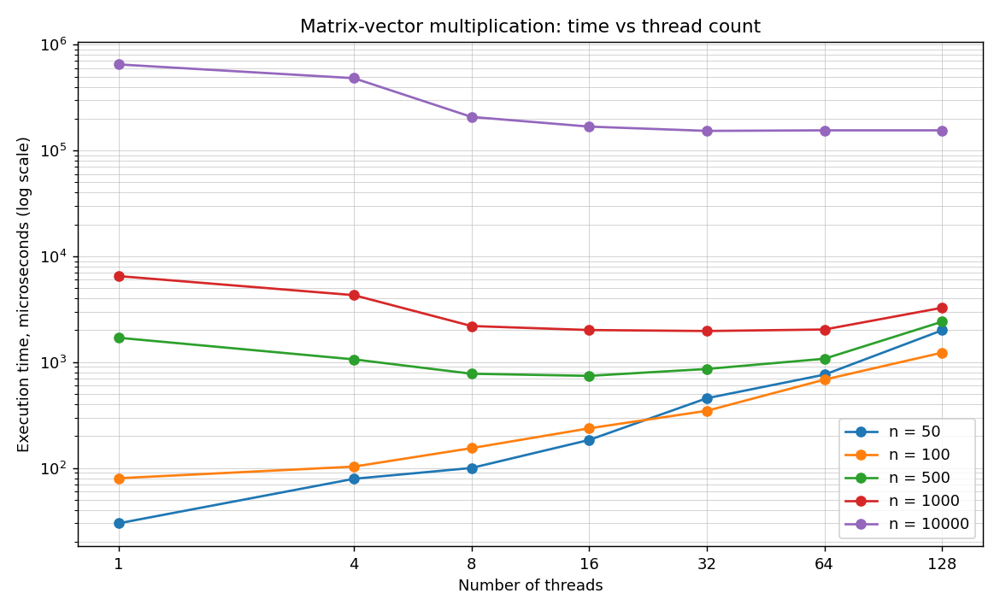

# Matrix-Vector Multiplication with Threads

Multiplying an `n × n` matrix by an `n`-element vector, sequentially and in parallel, to measure how the speedup depends on the number of threads and the size of the data.

## The idea

Each element of the result is the dot product of one matrix row with the vector, and the rows are independent. The parallel version gives each thread a disjoint range of rows, so no locking is needed: threads only ever write to their own part of the result.

```
result[i] = sum over j of matrix[i][j] * vec[j]
```

Rows are divided as evenly as possible: with `n` rows and `t` threads, each thread gets `n / t` rows and the first `n % t` threads take one extra, so chunk sizes differ by at most one.

## Benchmark

`benchmark` runs the multiplication for every matrix size (`n` = 50, 100, 500, 1000, 10000) and a range of thread counts relative to the number of logical cores (half the cores, the number of cores, and 2/4/8/16 times that, plus a single-thread baseline), prints a table and writes `results.csv`.

```bash
cmake -B build && cmake --build build
./build/benchmark
```

`plot_results.py` turns that CSV into a chart:

```bash
python3 plot_results.py        # reads results.csv, writes chart.png
```



## What the numbers show

- **Parallelism helps most on large data.** For `n = 10000` the time drops sharply up to the number of cores. For `n = 50` or `100` the work is so small that thread creation costs more than it saves, and more threads only make it slower.
- **The sweet spot is around the number of logical cores.** Past that, extra threads compete for the same cores and add scheduling overhead, so the curves flatten and then rise.

(The committed `results.csv` and chart were measured on an 8-core Apple M2. Re-running the benchmark overwrites them with numbers from the current machine.)

## Files

| File | Purpose |
| --- | --- |
| `matrix_vector.h/.cpp` | Sequential and parallel multiplication, matrix/vector generation |
| `main.cpp` | Benchmark harness that sweeps sizes and thread counts |
| `plot_results.py` | Draws the chart from `results.csv` |
